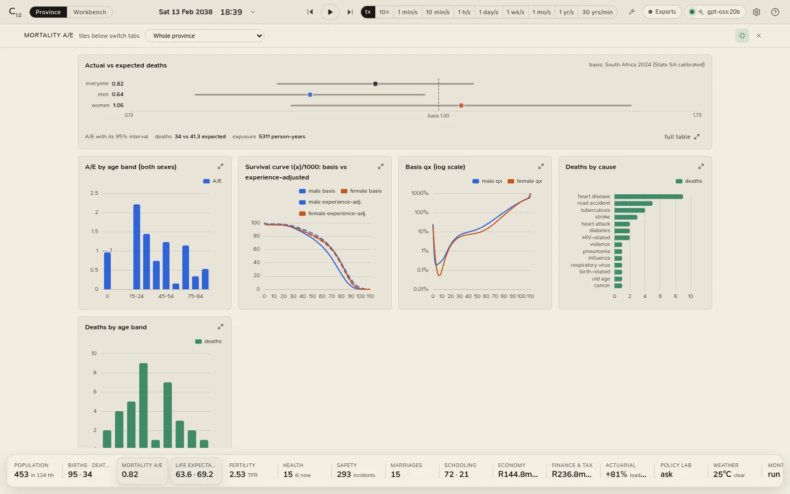

# Analytics

Everything the province does is counted, and the counts are along the bottom of the province view: the
**analytics strip**, sixteen tiles of headline figures. Click a tile and the **analytics drawer** slides up with that
subject's cards; click the lit tile again, or press <kbd>Esc</kbd>, to close it.

The same analytics work on a world built in the [Community Builder](../builder/index.md): the tiles, the drawer and
every tab read the world on screen, its cities and settlements, its people and its books, exactly as they read the
province.

<figure class="cl-shot" markdown>

<figcaption>The drawer at full screen, on Mortality A/E: deaths against the basis by age band and sex, survival curves, the basis qx and deaths by cause.</figcaption>
</figure>

## The tiles

| Tile | Shows | Opens |
|---|---|---|
| **Population** | Residents and households; children and over-65s | [Population](population.md#population) |
| **Births · deaths** | Births and deaths since the start, and this year | [Population](population.md#population) |
| **Mortality A/E** | Deaths against expected deaths on the basis | [Mortality and experience](mortality.md) |
| **Life expectancy** | e₀ on the basis for men and women, and adjusted for experience once there are enough deaths | [Mortality and experience](mortality.md) |
| **Fertility** | The realised TFR and births against the basis | [Fertility](population.md#fertility) |
| **Health** | Residents ill now, and in the ward | [Health](population.md#health) |
| **Safety** | Incidents, arrests and court cases | [Safety and the court](population.md#safety-and-the-court) |
| **Marriages** | Marriages, divorces and last Sunday's church attendance | [Social and church](population.md#social-and-church) |
| **Schooling** | At school and homeschooled | [Education](population.md#education) |
| **Economy** | GDP a year, inflation and the repo rate | [Economy and finance](economy.md), at the overview |
| **Finance & tax** | The Mutual Bank's deposits; the burial society's or SARS's state when either needs attention | [Economy and finance](economy.md), at the Mutual Bank |
| **Actuarial** | The burial society's premium loading over its pure risk premium | [The actuarial workbench](actuarial.md) |
| **Policy lab** | *ask*, or a running lab job's progress | [The policy and stress lab](lab.md) |
| **Weather** | Today's high and condition, the season, the rain | [Weather](population.md#weather) |
| **Monte Carlo** | *run* | [Monte Carlo](monte-carlo.md) |
| **Basis** | The basis hash | [The basis](#the-basis) |

A figure turns amber or red when it needs a look: an A/E above 1.5 or below 0.6, more than 15% of residents ill, a
society whose loading is under 10% (amber) or whose premiums no longer cover its pure risk premium (red), an
insolvent scheme, a taxpayer in arrears, inflation above 6%.

**View › Analytics** in the desktop app opens each subject's tab by name, including one the strip has no tile for:
**The burial society**, the scheme's surplus process (also in the finance workspace). **Run** opens the **Policy and
Stress Lab**, **Monte Carlo** and the **Basis**, and **View › Exports** the [exports](../exports/index.md).

## The drawer

While it is open, the drawer covers the whole stage: the map or the 3D view beneath is not drawn, and nothing of the
province shows around or through the cards. With the theme on **Follow the sim's daylight** (the default), the
colours hold steady while the drawer is open, in this device's light or dark theme (inside Scelo, Scelo's), so no
chart changes with the sim's day and night; the scene and its light come back as the drawer closes. The side panels
stay where they are.

- **Cards.** Each subject is a set of cards: a chart or a table with its note. A card with a summary shows a small
  chart and a key, and its button (**full table**, **full chart** or **history**) opens the whole card; any card can
  be **enlarged**. <kbd>Esc</kbd> closes an enlarged card.
- **Full screen.** The ⤢ button in the drawer's header makes the drawer fill the window below the top bar, over the
  side panels too, with the strip kept along the bottom; the cards grow to fill it, and on a large screen every card
  of a tab fits at once.
- **Scope.** The picker in the header narrows the analytics to one city, settlement, household or person. It narrows
  the *composition* cards (the pyramid, chronic conditions, relationships, schooling); rates that only make sense
  for the whole population (A/E, fertility) stay province-wide (world-wide on a built world), and the card says so.
  The economy, the finance workspace, weather, Monte Carlo, the lab, the basis and the exports have no picker.
- **The event ledger** is in the left panel, under **Events**: every birth, death, wedding, illness, incident,
  court case, weather event and economic event, newest first, filtered by *joy*, *sad*, *alert* or *danger*. Click
  one to go to whoever it involved.

## The basis

The **Basis** tile opens the assumptions the province lives on: the mortality table (qx by sex on a log
scale), every parameter and its value, the basis hash, and two downloads: **qx table (CSV)** (ages 0 to 110 by sex)
and **event ledger (CSV)** (every event the province has kept, with the people involved).

## Reading small numbers

The province is about four hundred people. A handful of them die in a year, and most cells of one province's
experience are empty, so every rate from one run is **noisy**, and the intervals say how noisy. Two tools exist for
exactly this:

- [Monte Carlo](monte-carlo.md) runs the same basis on many seeds and reports percentiles.
- The [policy and stress lab](lab.md) compares a change with the baseline seed by seed, which cancels most of the
  noise.

[Calibration and limits](../model/calibration.md) says what the province can and cannot be read for.
