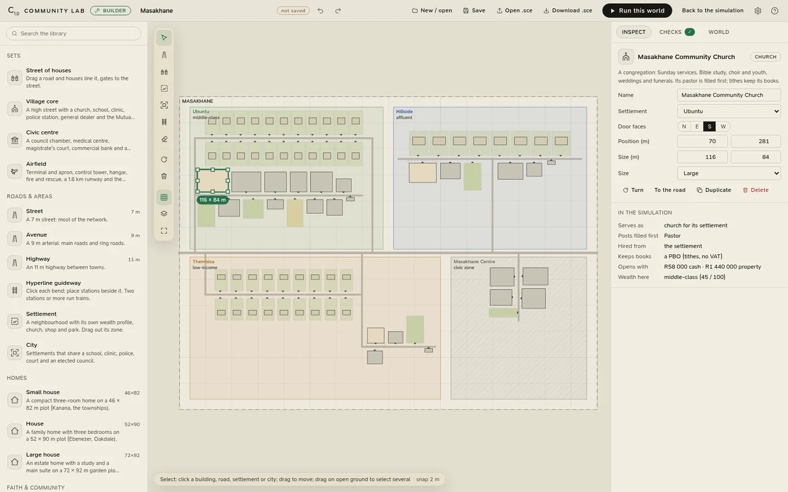
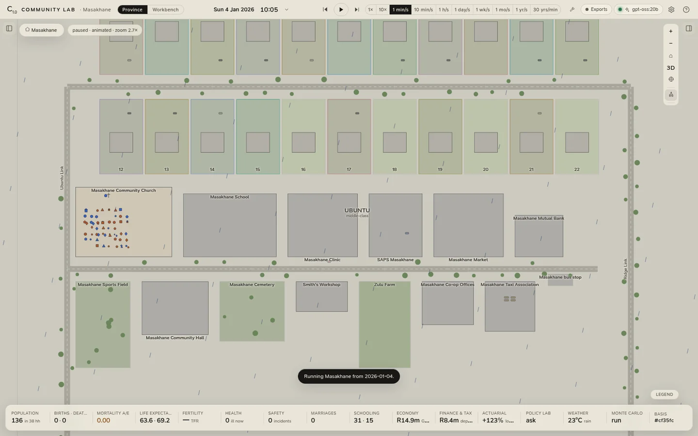

# The Community Builder

The province is one world; the **Community Builder** makes others. **Build** in the top bar opens it, and the
simulation waits behind it, unchanged, until you run a world or go **Back to the simulation**.

<figure class="cl-shot" markdown>

<figcaption>Masakhane in the builder, its village church selected: the library on the left, the drawing board with the Ubuntu, Hillside and Thembisa settlements and the civic centre, and on the right what the church will be in the simulation: whose church it is, which post is filled first and from where, and the books it opens with.</figcaption>
</figure>

## Starting a world

The builder opens on a choice:

| Start from | What you get |
|---|---|
| **Blank canvas** | An empty world with one city and one settlement, to build from the ground up. |
| **Masakhane, a small town** | About forty households in a village, a township and a hillside estate around a civic centre, to build on. |
| **Unity Province** | The built-in province itself, every building as drawn, to customise. |
| **Your worlds** | A world you saved. |
| **The world running now** | The built world the simulation is running, to change it (shown when one is). |
| **Open .sce** | A world someone shared with you, as a file. |

## Laying it out

The **library** on the left holds everything a world is made of: homes in three sizes; churches, halls, libraries
and cemeteries; schools; clinics, medical centres, the hospital and an ambulance station; police stations, courts,
council chambers, a post office and Government House; spazas, general dealers, delis, a pharmacy and the mall; the
Mutual Bank's branches, a commercial bank and the reserve bank; co-op offices, corporate towers, chambers,
workshops, farms and taxi ranks; parks, squares, a sports centre, the stadium and the concert hall; bus stops, the
terminus, Hyperline stations and the airfield. Each lays out its own rooms and furniture and says what it does in
the simulation.

- **Place** a building by picking it and clicking on the map. It turns its door to the nearest road and steps back
  to the road's building line, as the province's buildings do; <kbd>F</kbd> turns it, and holding <kbd>Alt</kbd>
  places it freely.
- **Sets** lay out several at once: a **street of houses** (drag a road and plots line it), a **village core**, a
  **civic centre**, the **airfield**.
- **Roads** are drawn by dragging. They run north to south or east to west, and their ends snap to the roads they
  meet.
- **Settlements** and **cities** are zones you drag out. Select one to drag its corners and sides, or a road to drag
  its ends. The **Hyperline's guideway** is drawn bend by bend (<kbd>Enter</kbd> ends it).
- **Select** anything to change it on the right: its name, its settlement, its door, its size and options, and
  what it will do in the simulation. Move, resize (within the asset's bounds), turn, duplicate and delete, one at a
  time or by marquee; undo and redo every step; snap to a 1, 2, 5 or 10 m grid.

## The people

A settlement's **wealth** (from the estates to low-income, or civic) decides how its households are drawn:
schooling, cars, cover, savings and work, from the scenario's tiers. Its **People here** sliders set one settlement
apart from its tier (more out of work, fewer cars, more cover), and ↺ takes a slider back.

A settlement uses its own church, shop, park and bus stop (each house its nearest, where there are several); a city
shares its school, clinic, police, court, cemetery and council. Every building brings the posts it cannot do
without (a pastor for a church, a doctor and two nurses for a clinic, three teachers for a school), filled first at
the start, and the businesses among them open books of their own.

## Checks

The **Checks** tab says what would stop the world from running (no homes, no shop, a door no road reaches, a road
network in pieces, buildings overlapping or off the map) and what a missing place will mean (no clinic: the sick
are nursed at home). Click a check to fly to it. A world with an error cannot run until it is fixed.

## Running it

**Run this world** builds it and starts the simulation from day 0 on the scenario's assumptions.

<figure class="cl-shot" markdown>

<figcaption>The same town running: its first Sunday morning, 136 people in 38 households, the congregation in the pews and the rain over Ubuntu's high street.</figcaption>
</figure>

Everything else in the app works on it as on the province: the animated day and the 3D close-up, the analytics,
the books, the bank and SARS, the actuarial workbench, projections, Monte Carlo, the
[policy and stress lab](../analytics/lab.md) and the [exports](../exports/index.md). In the lab, *in Masakhane, on its
basis* runs every arm in the world on screen; unticked, the arms run in the built-in province on the defaults. The
world's own hash goes into the basis hash and the assumptions hash, so every export says which world it came from,
and runs pool only within one world.

The derivation is held to the province: deriving the province's own plan gives back the built-in province, table for
table and building for building, and a run through that path is the built-in run. The rules, and what a built world
assumes that the province does not, are in [Assumptions and provenance](../model/assumptions.md).

## Keeping worlds

A world is a **`.sce` file**, the project file of the Scelo family.

- **Save** (<kbd>Ctrl</kbd>+<kbd>S</kbd>) keeps it in the lab, as `<name>.sce` in the `data/worlds` folder of the
  [app's folder](../reference/files.md), listed under *Your worlds*. Saving again replaces the file, under its new
  name if you renamed the world.
- **Download .sce** gives you a copy to keep or share; **Open .sce** opens one.
- Scelo opens the same file as a project whose dataset is the world's buildings, one row each. A `.sce` saved by
  Scelo is a dataset, not a world, and the builder says so.

## Keys

| Keys | Does |
|---|---|
| <kbd>V</kbd> | Select |
| <kbd>H</kbd>, or <kbd>Space</kbd> held | Move the map |
| <kbd>R</kbd> | Road |
| <kbd>S</kbd> | Street of houses |
| <kbd>Z</kbd> | Settlement |
| <kbd>C</kbd> | City |
| <kbd>T</kbd> | Hyperline guideway (<kbd>Enter</kbd> ends it) |
| <kbd>X</kbd> | Erase |
| <kbd>F</kbd> | Turn the selection |
| <kbd>Del</kbd>, <kbd>Backspace</kbd> | Delete the selection |
| Arrows (<kbd>Shift</kbd>: ten steps) | Nudge the selection, or move the map |
| <kbd>G</kbd> | Snapping on or off |
| <kbd>0</kbd> | Fit the world |
| <kbd>=</kbd>, <kbd>−</kbd> | Zoom in and out |
| <kbd>Esc</kbd> | Drop what is being drawn, then back to Select, then clear the selection |
| <kbd>Ctrl</kbd>+<kbd>Z</kbd> / <kbd>Ctrl</kbd>+<kbd>Y</kbd> (or <kbd>Ctrl</kbd>+<kbd>Shift</kbd>+<kbd>Z</kbd>) | Undo / redo |
| <kbd>Ctrl</kbd>+<kbd>D</kbd> | Duplicate the selection |
| <kbd>Ctrl</kbd>+<kbd>A</kbd> | Select every building |
| <kbd>Ctrl</kbd>+<kbd>S</kbd> | Save the world |

While the builder is open it is the whole window: the province's keys and <kbd>Ctrl</kbd>+<kbd>1</kbd> /
<kbd>Ctrl</kbd>+<kbd>2</kbd> wait until you leave it, and of the menus only Save, Settings and Help act.
