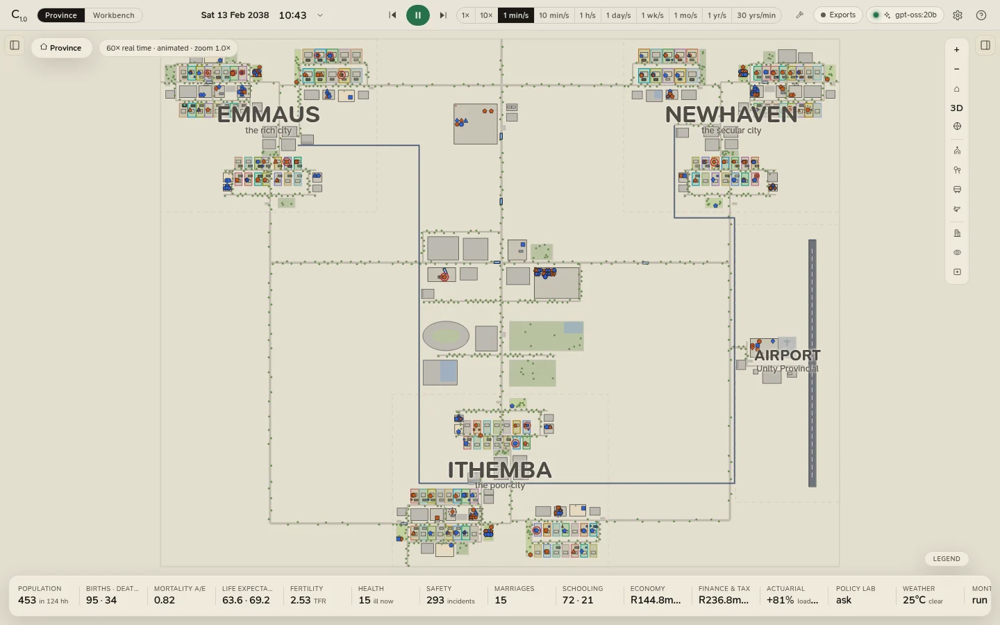

# The province

The province view is the simulation, live: Unity Province with every resident on the map, a clock you control, the
person or place you pick in an inspector, and the analytics along the bottom. Press **Ctrl+1** (or **Province** in
the top bar) to come back to it from the workbench.

A world built in the [Community Builder](../builder/index.md) runs in the same view, in the same way: everything on
these pages holds for it, with its own cities, settlements and names in place of the province's.

<figure class="cl-shot" markdown>

<figcaption>Unity Province on a Saturday morning: Emmaus to the north-west, Newhaven to the north-east, Ithemba to the south, Unity Centre between them and the airport to the south-east, joined by roads and the Hyperline. The analytics strip runs along the bottom.</figcaption>
</figure>

## The screen at a glance

| Part | Where | What it does |
|---|---|---|
| **Top bar** | Along the top | The view switch, the **clock**, play and pause, the **speed**, the **Exports** chip, the **model** chip, Settings and Help. |
| **Left panel** | Left, closed at first; <kbd>[</kbd> | *Scenario & basis* (the assumptions, and **Rebuild province**), the **Households** and **People** lists, and the **Events** ledger, which a filter narrows to *joy*, *sad*, *alert* or *danger*. |
| **The map** | The middle | The province: zoom from the whole of it down into a house, and past the rooms into the [3D close-up](3d.md). |
| **Inspector** | Right, closed at first; <kbd>]</kbd> | Whoever or whatever you selected: a person, a household, a building, a conversation. |
| **Analytics strip** | Along the bottom | Sixteen tiles of headline figures; each opens its part of the [analytics drawer](../analytics/index.md). While the drawer is open it covers the map, and the simulation goes on beneath it. |

Both side panels start closed so the province has the whole window. The buttons just under the top bar, at each
panel's corner, open them, and the app remembers your choice. Selecting something does not open the inspector by
itself: press <kbd>]</kbd> once and it stays open.

## The top bar

From left to right:

| Control | What it does |
|---|---|
| The C₁.₀ mark, *Community Lab* | The app; hover over the mark for its version. |
| *· name* | The name of a world built in the [Community Builder](../builder/index.md), while one is on screen. The province has no caption. |
| **Province · Workbench** | Switches views (<kbd>Ctrl</kbd>+<kbd>1</kbd>, <kbd>Ctrl</kbd>+<kbd>2</kbd>). |
| **The clock** | The date, the time, today's weather, the season, a public holiday when there is one, and the simulated years so far (*yr 0.0*). Click it to [set the scene](time.md#setting-the-scene): jump to a moment, a date or a season, or force the weather. A *forced* badge shows when the weather is forced. |
| **Rewind** | Rebuilds the world on screen at day 0 on the same seed and basis. |
| **Play / pause** | <kbd>Space</kbd>. The province starts paused. |
| **Step** | Pauses and moves on one simulated hour. |
| **Speed** | From real time to a year a second; keys <kbd>1</kbd> to <kbd>0</kbd>. A field beside it takes any number of simulated years a minute. See [Time and the clock](time.md). |
| **Build** | Opens the [Community Builder](../builder/index.md): build or change a community, then run it. |
| **Exports** | The data of the world on screen with its provenance, and importing a mortality table. Reads *Exports · basis* while the province lives on a table of your own or a stress. See [Exports and data](../exports/index.md). |
| **The model chip** | The language model that scripts conversations (*no model* when there is none), and the dialogue mode (*off*, *on-demand* or *auto*). Click it for Settings. Its light shows whether a model is ready, is writing, or cannot be reached. |
| **Settings**, **Help** | Settings (<kbd>Ctrl</kbd>+<kbd>,</kbd> in the desktop app) and the in-app help (<kbd>?</kbd>). |

## What to read next

- [Time and the clock](time.md): speeds, animated and time-lapse, jumping to moments, forcing the weather.
- [The map](map.md): moving about, what every mark means, following people.
- [People, households and places](inspector.md): the inspector.
- [Conversations](conversations.md): watching them, having a model script them, talking to a resident.
- [The 3D close-up](3d.md).
- [Scenario and basis](scenario.md): changing the assumptions and rebuilding the province.
