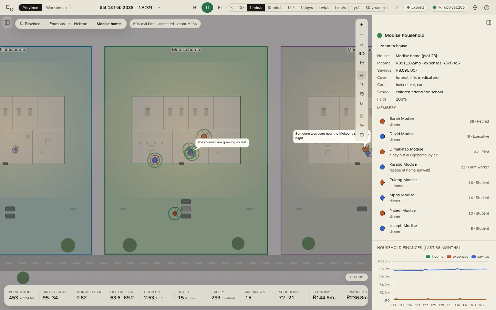

# People, households and places

Click a person, a house or a building on the map and the **inspector** (on the right; <kbd>]</kbd> opens it) shows
what the simulation knows about them. The **Households** and **People** lists in the left panel (<kbd>[</kbd>) find
anyone without the map: the Households list runs by city and plot, with each household's size, savings and cars,
and the People list searches by name, job or personality type. Click a row to select and fly to them.

<figure class="cl-shot" markdown>

<figcaption>A household at dinner time: the rooms, the members ringed in the plot's colour, and the inspector with the household's finances and this month's accounts.</figcaption>
</figure>

With nothing selected, the inspector lists the **Key people** (the pastor, the district medical officer, the
doctor, a police officer, the magistrate, where the world has them; click one to follow them) and the **Live
conversations**.

## A person

| Field | Shows |
|---|---|
| **Age** | Age, sex and stage of life. |
| **Type** | Personality type and its shape. |
| **Work** | Job, workplace and monthly income. |
| **Council** | The council seat they hold, if any. |
| **Payslip** | This month's gross pay, PAYE, UIF and net pay. |
| **SARS** | Their latest assessment (tax, and a refund or an amount owing), or the tax year to date. |
| **Education**, **Family** | Highest schooling, and the schooling under way; marital status, the partner's name and how many children are alive. |
| **Home** | Their household, plot, settlement and city. |
| **Now** | What they are doing, from when to when, and where: a building, a vehicle ("aboard the Hyperline", "in a minibus taxi", "driving for Hamba with a fare aboard"), a platform or a bus stop. |
| **Faith**, **Mood** | How likely they are to be at church, as a percentage; mood and stress, and whom they are grieving for. |
| **Health** | Health and vitality, any illness and its severity, whether it is being treated or they are in the ward, chronic conditions, a pregnancy and when it is due. |
| **Record** | Arrests, if any. |

Below that: their **Big Five** scores, **Today** (the day's plan as a timeline), their **Relationships** (the
strongest fourteen, each with its kind and strength; click a name to go to that person), their **Life history**
(the latest thirty entries) and, for anyone alive and still in the province, **Talk to …**, where you can ask them
questions (see [Conversations](conversations.md#talking-to-a-resident)).

Buttons at the top: **follow**, **household** (selects their household) and **conversation** (while they are in
one). The card's title carries *deceased* or *away* (with the reason) when that applies.

## A household

| Field | Shows |
|---|---|
| **House**, **Income**, **Savings** | Their house and plot, monthly income and expenses, savings, and whether they are below the poverty line. |
| **Cover**, **Cars** | Funeral, life and medical cover, and any months in arrears; their cars. |
| **School**, **Faith** | Whether the children go to school or are homeschooled; the household's faith, as a percentage. |
| **Members** | Click one to select and follow them. |

Then **Household finances (last 36 months)** (income, expenses, savings) and **Accounts · this month**: an income
statement that ends with what was saved this month, and a balance sheet that ends with net worth. **open the
ledger** opens the household's own books in the [finance workspace](../analytics/economy.md#the-books); **tax**
opens its tax position there. **zoom to house** flies to their plot.

## A building

Its kind, its rooms and **who is inside now**, by name, with what each is doing and in which room. The Mutual
Bank's building also shows its balance sheet in brief (deposits, loans, treasury bills, capital, capital adequacy
and liquidity, its rates) and **open the bank's books**; the cemetery lists its graves, by date.

## A conversation

Click someone who is talking, close up, and the inspector shows the **conversation**: who is in it (click a name to
follow them), where, its tone and topic, its status, and its **transcript** so far, line by line with the time.
**zoom in** flies to it. See [Conversations](conversations.md).

## An incident

Incidents are selected from the Safety tab's list of recent incidents: when and where, what happened and who
handled it, who was involved, the loss and any court case, with its charge, verdict and sentence.

Vehicles cannot be selected; select a passenger instead, and their card says what they are travelling in.
